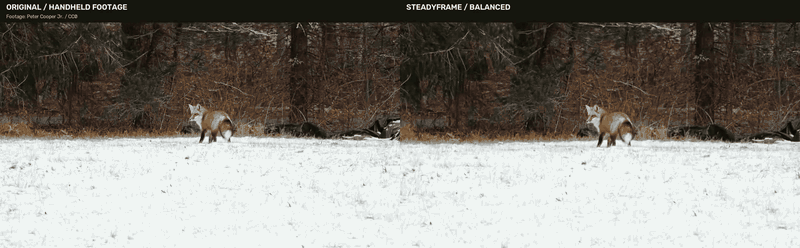
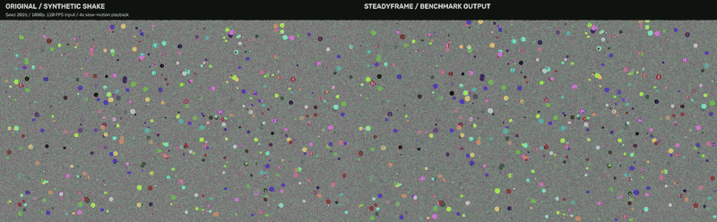

# SteadyFrame

[](https://github.com/varunmenon0/SteadyFrame/actions/workflows/tests.yml)

Offline video stabilization built with Python, OpenCV, and NumPy.



Real handheld footage, with the original on the left and SteadyFrame Balanced output on the right. This is an eight-second preview of the 20-second evaluated clip; no camera shake was added. [Watch the full comparison](docs/real-demo.mp4) · [Footage credit and processing details](docs/MEDIA.md).

### Synthetic benchmark — 97.30% measured jitter reduction



This comparison uses the exact 120 frames evaluated by the seeded 1080p / 120 FPS translation benchmark. Playback is slowed 4× for inspection; the full MP4 retains every evaluated frame. [Watch the benchmark comparison](docs/synthetic-benchmark.mp4) · [Measured results](benchmarks/synthetic-1080p120.json) · [Demo provenance](docs/synthetic-benchmark.json). The 97.30% result belongs to this controlled synthetic test; the real-footage results are reported separately below.

The pipeline detects up to 500 corners per frame, tracks them with Lucas–Kanade optical flow, rejects outliers with RANSAC, and estimates camera translation, rotation, and zoom. It smooths the reconstructed camera path and applies compensating transforms. Adaptive cropping and geometric recentering conceal exposed borders.

## Browser app


On a Mac, double-click **Open SteadyFrame.command** in the project folder. The launcher opens a local browser interface. First-time setup requires Python 3.10 or newer and an internet connection to install dependencies. Keep the launcher's window open while using the app; closing it stops the local server.

Upload a clip, choose Gentle, Balanced, or Strong smoothing, then click **Stabilize video**. The interface shows progress, original and stabilized previews, and downloads for the result and optional side-by-side video. Audio is retained by default. Previews play independently.

Before uploading, use the **Real footage** and **Synthetic benchmark** tabs to view both example comparisons.

Maximum zoom defaults to 1.25×. When a full correction would require more cropping, the app gradually eases stabilization to preserve framing. Increase the limit to allow a tighter crop, or lower it to retain more of the scene.

The browser interface accepts clips up to 500 MB, 60 seconds, 4K UHD (3840×2160) or DCI 4K (4096×2160), and 120 FPS input. Portrait orientations are supported too. It runs only on `127.0.0.1`; videos are processed on your computer. Temporary working files are removed after processing; preview copies stay in session memory until cleared by restarting the app. Browser exports use H.264/AAC for compatibility and require an additional encoding pass beyond stabilization.

4K clips retain their native output resolution. Feature tracking uses an analysis image capped at 1920 pixels on its longest edge, then maps tracked coordinates back to native pixels before estimating motion. Rendering and export use the full-resolution frames. Side-by-side exports are twice the input width.

For manual setup or other platforms:

```sh
git clone https://github.com/varunmenon0/SteadyFrame.git
cd SteadyFrame
python3 -m venv .venv
source .venv/bin/activate
pip install -e '.[dev,ui]'
steadyframe-ui
```

The interface opens at `http://127.0.0.1:8501`. Stop it with Ctrl+C in its launch window. On Windows, activate with `.venv\Scripts\activate` instead. The Mac launcher is not a signed desktop application.

## Command-line setup

```sh
python3 -m venv .venv
source .venv/bin/activate
pip install -e '.[dev]'
```

## Usage

```sh
steadyframe input.mp4 outputs/stabilized.mp4 --comparison outputs/comparison.mp4
```

The comparison shows the original video on the left and stabilized output on the right.

- `--radius 15`: smoothing radius in frames.
- `--zoom 1.05`: minimum crop zoom.
- `--max-zoom 1.25`: maximum adaptive crop magnification; stabilization eases where needed to respect this limit.
- `--fixed-crop`: disable adaptive cropping and recentering.
- `--comparison PATH`: save an optional side-by-side video.
- `--no-audio`: skip audio processing and export silent video.

Exports retain the first source audio track by default, including in comparison videos. FFmpeg copies the rendered video stream and encodes audio as AAC, trimmed to the rendered video duration. Silent inputs stay silent. The packaged FFmpeg executable is installed with the Python dependencies; no separate system installation is required. If audio muxing fails, the video-only export is retained and the command reports an error.

The command reports input frame rate, processing throughput, tracking failures, and crop statistics.

Abrupt changes in luminance distribution reset the camera path. Trajectory and crop-zoom smoothing run independently within each detected scene, preventing motion from one shot from influencing the next. Reports include the number of detected cuts and their zero-based frame indices.

Adaptive crop zoom anticipates upcoming motion peaks and eases back afterward. Its rate is limited to 0.15 zoom units per second while remaining at or above each frame's border-safe zoom requirement. This trades some field of view for smoother zoom transitions. Crop centers are smoothed within each shot over a quarter-second radius, followed by a fresh border-coverage calculation.

## Tests and benchmark

```sh
pytest
PYTHONPATH=src .venv/bin/python tools/benchmark.py
```

The benchmark generates a seeded 1920×1080 video at 120 FPS with translation shake and a constant pan. It measures translational jitter independently using phase correlation and RMS changes in frame displacement. Generated videos and a JSON report are saved to `outputs/benchmark/`.

The latest recorded synthetic translation benchmark reduced jitter by 97.30% with zero tracking failures, using 1080p footage at 120 FPS. Measured processing throughput was 28.75 FPS on arm64 with Python 3.12.10, OpenCV 5.0.0, and NumPy 2.5.4. Full results are in `benchmarks/synthetic-1080p120.json`; this generated fixture is separate from the real demo above.

On the published [VidStab ostrich sample](https://adamspannbauer.github.io/python_video_stab/html/module_docs.html), Balanced mode reduced estimated global motion jitter by 67.86% with a maximum crop zoom of 1.25×. The same clip previously measured 5.02% reduction and 1.98× peak zoom. This comparison uses the same 271 reliable frame triplets (87.4% coverage) across all versions, measured with independent ORB feature matching. Source identity, settings, revisions, and results are recorded in `benchmarks/real-footage-ostrich.json`; the third-party footage is not bundled.

Compare an original clip and one or more stabilized versions using shared reliable frame triplets:

```sh
python tools/evaluate_motion.py original.mp4 stabilized.mp4 --report outputs/motion-report.json
```

Clips must have matching frame counts, dimensions, and frame rates. The evaluator reports global image-motion estimates, including rotation, and refuses a score if shared tracking coverage is below 80%. It uses a different metric from the synthetic translation benchmark above.

Three additional real-footage tests used the first 20 seconds of each recording, Balanced settings, and the same 1.25× crop ceiling:

| Clip | Estimated jitter reduction | Peak crop zoom | Shared tracking coverage |
| --- | ---: | ---: | ---: |
| Handheld fox recording — shown in demo | 76.46% | 1.10× | 99.8% |
| Trail walking at dusk | 52.82% | 1.12× | 99.7% |
| Portrait riverside walk | Not scored | 1.25× | 35.3% |

The riverside clip exported but did not meet the evaluator's coverage threshold. Source links, attribution, hashes, preprocessing, and per-clip reports are in `benchmarks/real-footage-suite.json`. The real demo uses the strongest scored clip from this set, not an aggregate result.

Build a labeled comparison from matched original and stabilized clips:

```sh
python tools/make_comparison.py original.mp4 stabilized.mp4 --credit 'Footage: author / license'
```

For the bundled real demo, use the fox inputs described in the suite report. It writes the full comparison MP4 and an eight-second GIF preview. See [media credits](docs/MEDIA.md) for the source and modifications.

Regenerate the visual demo, comparison video, and GIF preview:

```sh
PYTHONPATH=src .venv/bin/python tools/demo.py
```

This last command regenerates the separate [synthetic demo](docs/demo.gif).

## License

SteadyFrame's code is released under the [MIT License](LICENSE), copyright 2026 Varun Menon. Third-party demo footage retains its original terms; see [media credits](docs/MEDIA.md).

