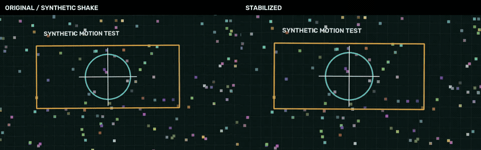
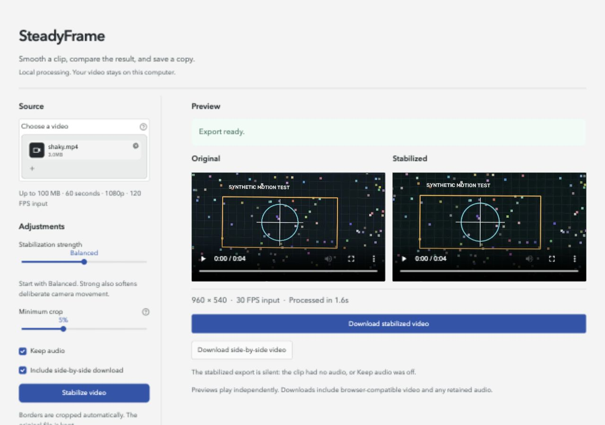

# SteadyFrame

[](https://github.com/varunmenon0/SteadyFrame/actions/workflows/tests.yml)

Offline video stabilization built with Python, OpenCV, and NumPy.



This reproducible synthetic demo combines translation and rotation shake with a slow intended pan. Original footage is on the left; stabilized output is on the right. It is not a real-footage evaluation.

The pipeline detects up to 500 corners per frame, tracks them with Lucas–Kanade optical flow, rejects outliers with RANSAC, and estimates camera translation and rotation. It smooths the reconstructed camera path and applies compensating transforms. Adaptive cropping and geometric recentering conceal exposed borders.

## Browser app



On a Mac, double-click **Open SteadyFrame.command** in the project folder. The launcher opens a local browser interface. First-time setup requires Python 3.10 or newer and an internet connection to install dependencies. Keep the launcher's window open while using the app; closing it stops the local server.

Upload a clip, choose Gentle, Balanced, or Strong smoothing, then click **Stabilize video**. The interface shows progress, original and stabilized previews, and downloads for the result and optional side-by-side video. Audio is retained by default. Previews play independently.

The browser interface accepts clips up to 100 MB, 60 seconds, 1080p (landscape or portrait), and 120 FPS input. It runs only on `127.0.0.1`; videos are processed on your computer. Temporary working files are removed after processing; preview copies stay in session memory until cleared by restarting the app. Browser exports use H.264/AAC for compatibility and require an additional encoding pass beyond stabilization.

For manual setup or other platforms:

```sh
git clone https://github.com/varunmenon0/SteadyFrame.git
cd SteadyFrame
python3 -m venv .venv
source .venv/bin/activate
pip install -e '.[dev,ui]'
steadyframe-ui
```

The interface opens at `http://127.0.0.1:8501`. Stop it with Ctrl+C in its launch window. On Windows, activate with `.venv\Scripts\activate` instead. The Mac launcher is not a signed desktop application.

## Command-line setup

```sh
python3 -m venv .venv
source .venv/bin/activate
pip install -e '.[dev]'
```

## Usage

```sh
steadyframe input.mp4 outputs/stabilized.mp4 --comparison outputs/comparison.mp4
```

The comparison shows the original video on the left and stabilized output on the right.

- `--radius 15`: smoothing radius in frames.
- `--zoom 1.05`: minimum crop zoom.
- `--fixed-crop`: disable adaptive cropping and recentering.
- `--comparison PATH`: save an optional side-by-side video.
- `--no-audio`: skip audio processing and export silent video.

Exports retain the first source audio track by default, including in comparison videos. FFmpeg copies the rendered video stream and encodes audio as AAC, trimmed to the rendered video duration. Silent inputs stay silent. The packaged FFmpeg executable is installed with the Python dependencies; no separate system installation is required. If audio muxing fails, the video-only export is retained and the command reports an error.

The command reports input frame rate, processing throughput, tracking failures, and crop statistics.

Abrupt changes in luminance distribution reset the camera path. Trajectory and crop-zoom smoothing run independently within each detected scene, preventing motion from one shot from influencing the next. Reports include the number of detected cuts and their zero-based frame indices.

Adaptive crop zoom anticipates upcoming motion peaks and eases back afterward. Its rate is limited to 0.15 zoom units per second while remaining at or above each frame's border-safe zoom requirement. This trades some field of view for smoother zoom transitions. Crop centers are smoothed within each shot over a quarter-second radius, followed by a fresh border-coverage calculation.

## Tests and benchmark

```sh
pytest
PYTHONPATH=src .venv/bin/python tools/benchmark.py
```

The benchmark generates a seeded 1920×1080 video at 120 FPS with translation shake and a constant pan. It measures translational jitter independently using phase correlation and RMS changes in frame displacement. Generated videos and a JSON report are saved to `outputs/benchmark/`.

The latest recorded synthetic translation benchmark reduced jitter by 97.28% and processed 27.41 frames per second with zero tracking failures. The environment was arm64, Python 3.12.10, OpenCV 5.0.0, and NumPy 2.5.4. Full results are in `benchmarks/synthetic-1080p120.json`. Input frame rate and processing throughput are separate measurements; these results do not establish real-time 120 FPS processing or performance on real footage. The rotation-containing visual demo above is a separate fixture and is not the source of this metric.

Regenerate the visual demo, comparison video, and GIF preview:

```sh
PYTHONPATH=src .venv/bin/python tools/demo.py
```

## Limitations

- Retains the first audio track as AAC; additional tracks, subtitles, and original metadata are not preserved.
- Uses two offline passes and constant frame rate encoding.
- Models translation and rotation; parallax, rolling shutter, and large foreground motion need additional handling.
- Scene-cut detection is a conservative luminance heuristic. It can miss similarly lit cuts or treat a strong exposure flash as a cut; it does not handle gradual transitions.
- Falls back to identity motion when tracking fails and reports those failures.
- Adaptive cropping can produce large zoom values under strong motion. If the smoothed center leaves the source footprint, the crop falls back to the transformed image center, which can cause a jump. Recentring is geometric and does not track a subject.
- Fixed cropping reflects exposed borders.
